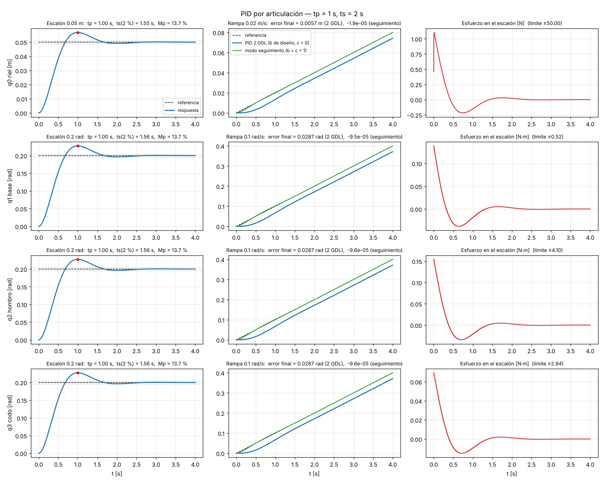
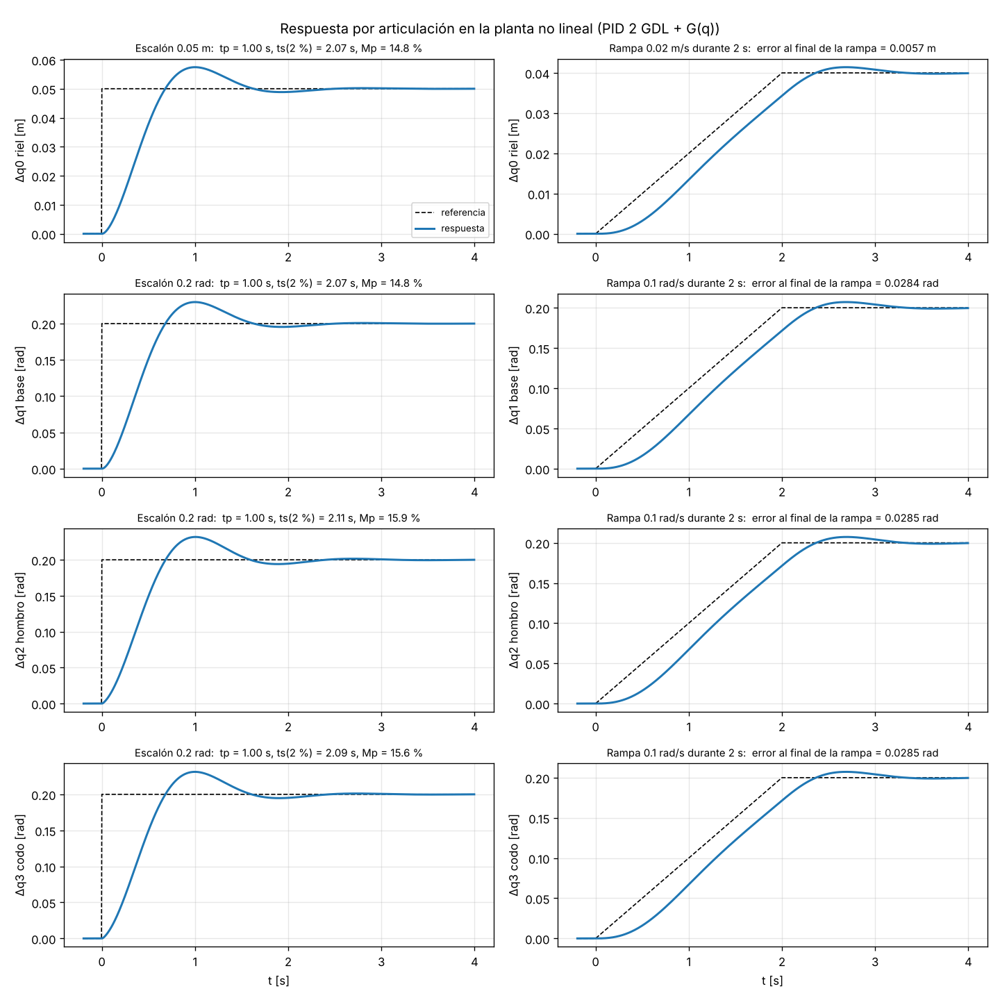
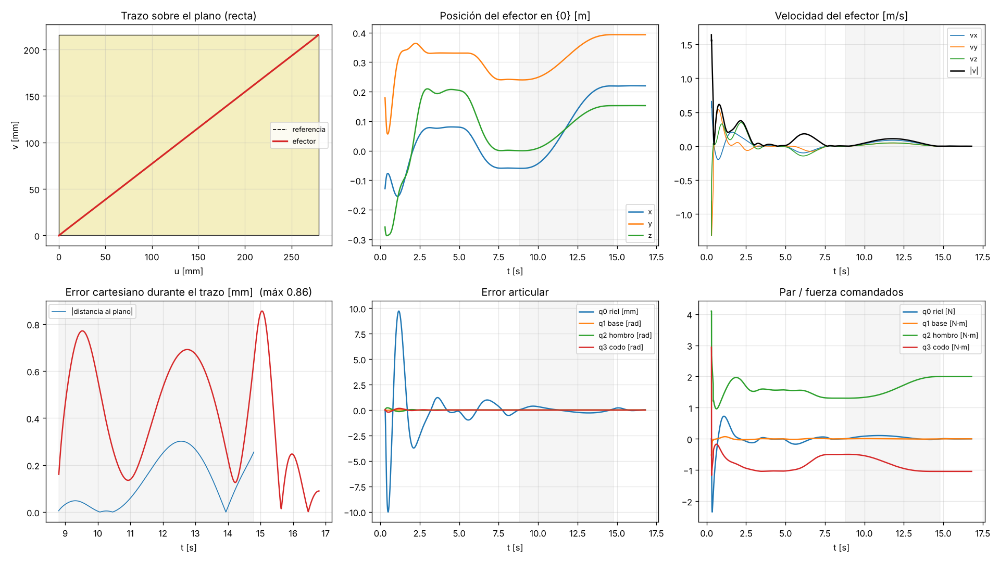
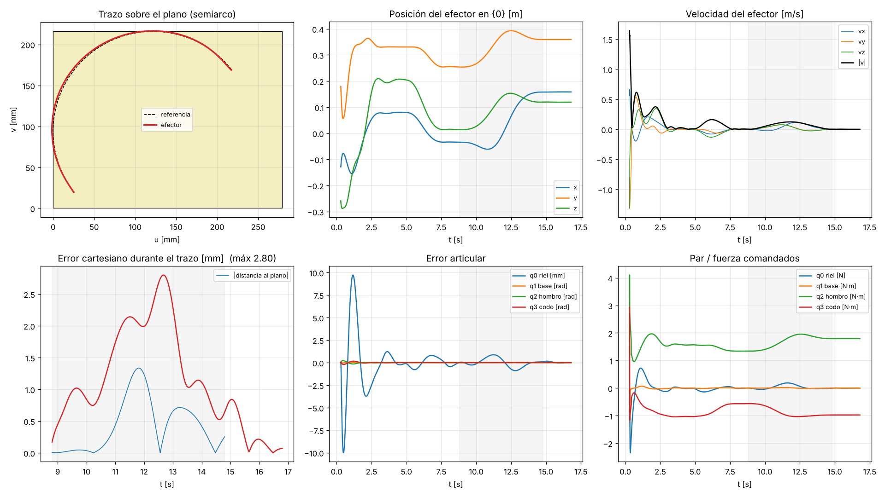
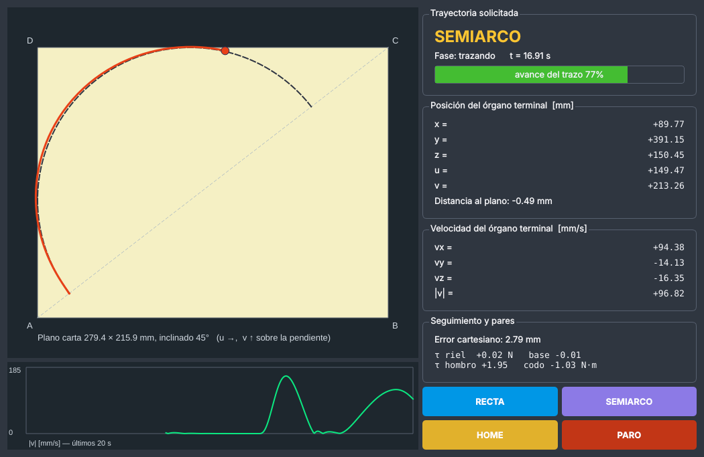

# Universidad Nacional Autónoma de México — Facultad de Ingeniería
## Diseño Mecatrónico
### Manipulador de 3 GDL + gripper sobre riel lineal — ROS 2 Jazzy, Gazebo Harmonic y ESP32

Diseñado y ensamblado por:
- Fuentes Yañez Ivan
- Garduño Cruz Ingrid Paola
- Huarancca Panana Irvin Daymont
- López Cruz Marino
- Ortíz Martínez Raúl

---

## Tabla de Contenidos

- [Descripción del Proyecto](#descripción-del-proyecto)
- [Entrega 3 — Propuesta: control de torque en Gazebo](#entrega-3--propuesta-control-de-torque-en-gazebo)
  - [1. Qué cambia respecto al planteamiento cinemático](#1-qué-cambia-respecto-al-planteamiento-cinemático)
  - [2. Arquitectura del lazo de torque](#2-arquitectura-del-lazo-de-torque)
  - [3. Cambios hechos en el repositorio](#3-cambios-hechos-en-el-repositorio)
  - [4. Parte 1 — Modelo físico y constantes](#4-parte-1--modelo-físico-y-constantes)
  - [5. Parte 1 — Sintonización de los PID](#5-parte-1--sintonización-de-los-pid-tp--1-s-ts--2-s)
  - [6. Parte 1 — Respuesta a escalón y rampa](#6-parte-1--respuesta-a-escalón-y-rampa)
  - [7. Validación con la dinámica completa](#7-validación-con-la-dinámica-completa-recta-y-semiarco)
  - [8. Parte 2 — Prototipo, interfaz y corridas](#8-parte-2--prototipo-interfaz-y-corridas)
  - [9. Guion sugerido para el video](#9-guion-sugerido-para-el-video-máx-8-min)
  - [10. Limitaciones y pendientes](#10-limitaciones-y-pendientes)
- [Arquitectura del Sistema](#arquitectura-del-sistema)
- [Estructura de Archivos](#estructura-de-archivos)
- [Descripción de los Códigos](#descripción-de-los-códigos)
- [Requisitos Previos](#requisitos-previos)
- [Instalación y Configuración](#instalación-y-configuración)
- [Instrucciones para Echar a Andar el Robot](#instrucciones-para-echar-a-andar-el-robot)
- [Solución de Problemas Comunes](#solución-de-problemas-comunes)
- [Notas Técnicas](#notas-técnicas)

---

## Descripción del Proyecto

Manipulador serial montado sobre un **riel lineal**, con giro de base, hombro, codo y un **gripper**. Se opera con **ROS 2 Jazzy**; se simula en **Gazebo Harmonic** (`gz_ros2_control`) y el prototipo físico se mueve con un **ESP32** (motor a pasos + servos de bus serial).

### Articulaciones

El modelo es `Diseño_Final_Brazo_carro_5` (`src/arm_description/urdf/arm_description.xacro`). El orden `q0…q3` es el mismo en todo el proyecto.

| Coord. | Articulación (xacro) | Tipo | Límite | Trama ESP32 |
|---|---|---|---|---|
| `q0` | `moviento_en_x` | prismática, eje X (riel) | 0 – 0.30 m | `V1` → motor a pasos |
| `q1` | `disco_soportes_rotacion` | rotativa, eje vertical (giro de la base) | ±2.094 rad | `V2` → servo ID 1 |
| `q2` | `brazo_motores` | rotativa, cabeceo (hombro) | ±2.094 rad | `V3` → servo ID 2 |
| `q3` | `brazo_gripper_azul` | rotativa, cabeceo (codo) | ±2.094 rad | `V4` → servo ID 3 |
| — | `gripper_mecanismo` | gripper | 0 (cerrado) – 1 (abierto) | `V5` → SG90 |

> En el firmware los servos ID 1, 2 y 3 se llaman `ID_HOMBRO`, `ID_CODO` e `ID_MUNECA`; físicamente corresponden a base, hombro y codo (el orden de la trama es el que manda).

Dimensiones (del xacro): altura del eje del hombro `L1 = 99.35 mm`, hombro→codo `L2 = 170 mm`, codo→punto de agarre `L3 = 240 mm`, masa móvil total 1.60 kg incluyendo una carga de 400 g.

---

## Entrega 3 — Propuesta: control de torque en Gazebo

**Objetivo de la entrega:** con la información de la segunda entrega (cinemática, dinámica y selección de actuadores), construir un sistema de control sencillo pero efectivo que mantenga la operabilidad del manipulador.

**Propuesta:** dejar de tratar el problema como cinemático (mandar posiciones y que el simulador las imponga) y **controlar el par de cada articulación**. Gazebo ya integra la dinámica del brazo (masas e inercias del xacro), así que basta con cambiar la interfaz de comando de `position` a `effort` y cerrar el lazo nosotros:

$$\tau_i = \underbrace{K_{p,i}\,e_i + K_{i,i}\!\int e_i\,dt + K_{d,i}\,\dot e_i}_{\text{PID de la articulación } i} + \underbrace{G_i(q)}_{\text{compensación de gravedad}},\qquad e_i = q_{ref,i} - q_i$$

### 1. Qué cambia respecto al planteamiento cinemático

| | Antes (cinemático) | Propuesta (torque) |
|---|---|---|
| Interfaz en Gazebo | `position`: el simulador coloca la articulación donde se le pide | `effort`: el simulador solo recibe N y N·m |
| ¿Quién sigue la trayectoria? | `JointTrajectoryController` interpola posiciones | Un PID por articulación calcula el par |
| Dinámica (inercia, gravedad, acoplamiento) | No interviene | Interviene: es la planta que se controla |
| Qué se puede evaluar | Solo la geometría del movimiento | Tiempo pico, asentamiento, error, pares pico y saturación de cada motor |
| Robot real | Sin cambios (`modo:=mock`, servos en posición) | Sin cambios; ver [limitaciones](#10-limitaciones-y-pendientes) |

El modo cinemático **no se eliminó**: sigue disponible con `modo:=gazebo_posicion` y es el que usa el robot real.

### 2. Arquitectura del lazo de torque

```
                 /trayectoria/comando  (recta | semiarco | home | paro | escalon i | rampa i)
interfaz_trayectoria.py ───────────────────────────────┐
        ▲                                               ▼
        │ /trayectoria/estado            ┌──────────────────────────────────┐
        │ /efector/posicion              │        control_torque.py         │
        └────────────────────────────────│  generador de trayectoria (CI)   │
          /efector/velocidad             │  PID por articulación + G(q)     │
                                         │  modelo del actuador (motor CD)  │
                                         └───────┬──────────────────▲───────┘
                     /effort_controller/commands │                  │ /joint_states
                     [N, N·m, N·m, N·m]          ▼                  │ (posición y velocidad, 250 Hz)
                                    ┌─────────────────────┐   ┌─────┴──────────────────┐
                                    │ effort_controller   │   │ joint_state_broadcaster│
                                    │ (ForwardCommand)    │   │                        │
                                    └──────────┬──────────┘   └─────▲──────────────────┘
                                               ▼                    │
                                    ┌──────────────────────────────────────────┐
                                    │ Gazebo Harmonic + gz_ros2_control        │
                                    │ dinámica de cuerpo rígido del xacro      │
                                    └──────────────────────────────────────────┘
```

- **Sensores:** posición y velocidad articular de `/joint_states` (equivalente a los encoders de los servos).
- **Actuadores:** par/fuerza por articulación; los cuatro se comandan simultáneamente en cada ciclo.
- **Un solo modelo:** `modelo_brazo.py` lee masas, inercias, ejes, límites y amortiguamiento directamente del xacro que carga Gazebo. De ahí salen `G(q)`, `M(q)`, la cinemática directa y el jacobiano, así que el controlador y la planta no pueden desalinearse (no hay ceros ni signos supuestos a mano).
- **Un solo controlador:** `nucleo_control.py` no depende de ROS. Lo ejecutan igual el nodo de Gazebo y la simulación sin ROS (`simulacion_offline.py`).

### 3. Cambios hechos en el repositorio

**Nuevos**

| Archivo | Función |
|---|---|
| `scripts/modelo_brazo.py` | Modelo cinemático/dinámico leído del xacro, plano de trabajo, lugares geométricos y cinemática inversa |
| `scripts/diseno_pid.py` | Constantes de los motores, sintonización de los PID, respuestas a escalón y rampa |
| `scripts/nucleo_control.py` | Ley de control `PID + G(q)`, generador de trayectorias y máquina de estados |
| `scripts/control_torque.py` | Nodo ROS 2 que cierra el lazo contra Gazebo |
| `scripts/interfaz_trayectoria.py` | Interfaz: tipo de trayectoria, posición y velocidad del efector en tiempo real |
| `scripts/simulacion_offline.py` | Validación con la dinámica completa, sin ROS ni Gazebo |
| `config/arm_controllers_torque.yaml` | `effort_controller` (ForwardCommandController) + gripper en posición |
| `docs/img/*.png` | Gráficas generadas por los scripts anteriores |

**Modificados**

| Archivo | Cambio |
|---|---|
| `urdf/arm_description.xacro` | Ahora es un xacro real con argumento `modo` (`gazebo_torque` \| `gazebo_posicion` \| `mock`); interfaz `effort` en modo torque; `<dynamics damping>` y límites de esfuerzo/velocidad de los actuadores propuestos |
| `launch/gazebo.launch.py` | Argumentos `modo` e `interfaz`; lanza `effort_controller`, `gripper_controller`, `control_torque.py` y la interfaz |
| `launch/real_robot.launch.py` | Procesa el xacro con `xacro … modo:=mock` en lugar de `cat` |

**Errores de la base corregidos**

| Problema | Corrección |
|---|---|
| El xacro traía fijo `mock_components/GenericSystem`: `gazebo.launch.py` abría Gazebo pero el robot no quedaba controlado por `gz_ros2_control` (había que editar el archivo a mano) | El plugin de hardware se elige con `modo:=` |
| `real_robot.launch.py` leía el xacro con `cat` aunque contiene `$(find …)` | Se procesa con `xacro` |
| `CMakeLists.txt` instalaba la carpeta `rviz/`, que no existe → `colcon build` fallaba al instalar | Se quitó; se agregaron los scripts nuevos |
| `gazebo.launch.py` nunca activaba `gripper_controller` | Se activa en ambos modos |
| `package.xml` no declaraba `ros2_control`, Gazebo, `rclpy`, PyQt5, pyserial… (`rosdep install` no instalaba nada útil) | Dependencias completas |
| Límite del gripper `0 – 6.2831` contra el `0 – 1` que usan la GUI y el firmware | `upper="1.0"` |
| Etiquetas cruzadas: `disco_soportes_rotacion` aparecía como "hombro" y `brazo_gripper_azul` como "muñeca" en el xacro, el yaml, `teach_repeat.py` y `serial_bridge.py` | Base / hombro / codo en todos lados (solo texto; el orden de la trama no cambia) |
| `serial_bridge.py` y `teach_pendant_gui.py` sin permiso de ejecución (`ros2 run` falla con `--symlink-install`) | `chmod +x` |
| `driver_esp32.ino` usa `esp_task_wdt_*` sin incluir su cabecera | `#include <esp_task_wdt.h>` |
| `a.gitignore` no era leído por git; `.vscode/` y un archivo vacío `ssh` estaban versionados | Renombrado a `.gitignore`; se dejaron de versionar |
| Este README describía archivos y articulaciones que no existen (`Motor_Base`, `arm_description_v2.xacro`, `display.launch.py`, ROS 2 Humble…) | Reescrito conforme al repositorio |

### 4. Parte 1 — Modelo físico y constantes

Cada articulación se modela como un motor de CD con reducción, referido al eje de salida (para el riel, al carro):

$$V = R_a\,i + L_a\frac{di}{dt} + K_b\,\omega,\qquad \tau = K_t\,i,\qquad J\dot\omega + B\,\omega = \tau - \tau_{carga}$$

El lazo interno de par compensa la fuerza contraelectromotriz, $V = R_a\,i^* + K_b\,\omega$ con $i^* = \tau^*/K_t$, de modo que $\tau/\tau^* = 1/(t_e s + 1)$ con $t_e = L_a/R_a$, y la planta que ve el PID es

$$\frac{q(s)}{\tau^*(s)} = \frac{1}{s\,(Js + B)\,(t_e s + 1)}$$

Como $t_e < 2$ ms frente a una dinámica de lazo de ~1 s, para sintonizar se usa $1/[s(Js+B)]$; las simulaciones sí incluyen $t_e$ y el límite de tensión.

Actuadores: **propuesta 1 de la entrega 2**.

| | `q0` riel | `q1` base | `q2` hombro | `q3` codo |
|---|---|---|---|---|
| Actuador | NEMA 17 17HS4401 + polea GT2 20T | Dynamixel XL330-M288-T | Dynamixel XM430-W350-R | Feetech STS3215 |
| Tensión nominal $V_n$ | 12 V | 5 V | 12 V | 12 V |
| Par de paro / sostenimiento | 0.40 N·m (62.8 N en el carro) | 0.52 N·m | 4.10 N·m | 2.94 N·m |
| Corriente de paro / nominal | 1.7 A | 1.47 A | 2.30 A | 2.70 A |
| Velocidad en vacío | — | 103 rpm | 46 rpm | 62 rpm |
| Reducción $N$ | $1/r$, $r = 6.366$ mm | 288.35 | 353.5 | 345 |
| **Resistencia de armadura $R_a$** | 1.50 Ω | 3.40 Ω | 5.22 Ω | 4.44 Ω |
| **Inductancia de armadura $L_a$** | 2.8 mH | 0.3 mH ⚠ | 0.2 mH ⚠ | 1.0 mH ⚠ |
| **Constante de par (armadura) $K_t$** | 36.96 N/A | 0.354 N·m/A | 1.783 N·m/A | 1.089 N·m/A |
| **Constante de f.c.e.m. $K_b$** | 36.96 V·s/m | 0.464 V·s/rad | 2.491 V·s/rad | 1.848 V·s/rad |
| Constante eléctrica $t_e = L_a/R_a$ | 1.87 ms | 0.09 ms | 0.04 ms | 0.23 ms |
| Inercia del rotor $J_m$ | 5.4×10⁻⁶ kg·m² | 3×10⁻⁸ ⚠ | 2×10⁻⁷ ⚠ | 2×10⁻⁷ ⚠ |
| Inercia del rotor reflejada $N^2 J_m$ | 0.133 kg | 0.0025 kg·m² | 0.0250 kg·m² | 0.0238 kg·m² |
| **Inercia de la carga $J$** (de $M(q)$ en *home*) | 1.6025 kg | 0.0500 kg·m² | 0.0556 kg·m² | 0.0250 kg·m² |
| **Fricción viscosa $B$** | 2.0 N·s/m ⚠ | 0.0024 N·m·s/rad ⚠ | 0.0426 ⚠ | 0.0226 ⚠ |
| Límite de esfuerzo usado | 50 N | 0.52 N·m | 4.10 N·m | 2.94 N·m |

Cómo se obtuvo cada valor (`diseno_pid.py`, función `constantes_motor`):

- **Servos:** $R_a = V_n / I_{paro}$, $K_t = T_{paro}/I_{paro}$ y $K_b = V_n/\omega_0$, con los datos nominales de catálogo de la tabla 6 de la entrega 2. El cociente $K_t/K_b$ (0.59 – 0.76) es la eficiencia de la reducción.
- **Motor a pasos:** se trata como motor síncrono equivalente, $K_t = T_{sost}/I_{nom} = 0.235$ N·m/A y $K_b = K_t$ en SI; la polea de 20 dientes (radio 6.366 mm) los convierte a N/A y V·s/m. $R_a$, $L_a$ y $J_m$ son los de la hoja de datos del 17HS4401.
- **Inercia $J$:** elemento diagonal de la matriz de inercia $M(q)$ calculada del xacro en la postura *home*; es la inercia que ve la articulación con las demás sostenidas.
- **⚠ Valores estimados (no vienen en las hojas de datos de los servos):** $L_a$ y $J_m$ son órdenes de magnitud típicos de motores de ese tamaño; $B$ se supuso como el 5 % del par de paro a la velocidad en vacío (2 N·s/m para la guía lineal). **Deben medirse o identificarse en los motores reales antes de usarse en hardware.** $B$ está escrito en el `<dynamics damping>` del xacro, de modo que Gazebo y el diseño usan el mismo número.

> **Inercia del rotor.** Gazebo simula solo los eslabones, por eso las ganancias por defecto usan la inercia de la carga. Para el hardware real hay que sumar $N^2 J_m$ (que en el hombro y el codo es comparable a la carga): `python3 diseno_pid.py --rotor`, o el parámetro `incluir_rotor:=true` del nodo. Las ganancias escalan linealmente con $J$.

### 5. Parte 1 — Sintonización de los PID ($t_p$ = 1 s, $t_s$ = 2 s)

Se usa un **PID de dos grados de libertad**:

$$\tau^* = K_p\,(b\,r - q) + K_i\!\int (r - q)\,dt + K_d\,(c\,\dot r - \dot q) + G(q)$$

Con la planta $1/[s(Js+B)]$ el polinomio característico es $J s^3 + (B + K_d)s^2 + K_p s + K_i$. Se iguala a $J\,(s^2 + 2\zeta\omega_n s + \omega_n^2)(s + p)$:

1. De las especificaciones: $\sigma = 4/t_s = 2\ \text{s}^{-1}$ y $\omega_d = \pi/t_p = 3.142$ rad/s  →  $\omega_n = \sqrt{\sigma^2+\omega_d^2} = 3.724$ rad/s, $\zeta = \sigma/\omega_n = 0.537$, sobrepaso $M_p = e^{-\sigma\pi/\omega_d} = 13.5\ \%$.
2. Tercer polo real cinco veces más rápido: $p = 5\sigma = 10$ rad/s.
3. Ganancias:

$$K_p = J(\omega_n^2 + 2\zeta\omega_n p),\qquad K_i = J\,\omega_n^2\,p,\qquad K_d = J(2\zeta\omega_n + p) - B$$

4. Peso de la referencia $b = \dfrac{\omega_n^2}{\omega_n^2 + 2\zeta\omega_n p} = 0.2575$ y $c = 0$: el cero del controlador cancela el polo $p$ y queda **exactamente** $\dfrac{q}{r} = \dfrac{\omega_n^2}{s^2 + 2\zeta\omega_n s + \omega_n^2}$. Con $b = 1$ (proporcional sobre el error) y los mismos polos, el cero sin cancelar da ≈ 37 % de sobrepaso y $t_p \approx 0.68$ s: no cumple la especificación.

Ganancias resultantes (planta de Gazebo):

| Articulación | $J$ | $K_p$ | $K_i$ | $K_d$ |
|---|---|---|---|---|
| `q0` riel | 1.6025 kg | 86.33 N/m | 222.26 N/(m·s) | 20.43 N·s/m |
| `q1` base | 0.0500 kg·m² | 2.692 N·m/rad | 6.931 N·m/(rad·s) | 0.697 N·m·s/rad |
| `q2` hombro | 0.0556 kg·m² | 2.997 | 7.716 | 0.736 |
| `q3` codo | 0.0250 kg·m² | 1.347 | 3.468 | 0.328 |

Con la inercia de rotor reflejada (`--rotor`, para hardware): riel 93.50 / 240.74 / 22.30; base 2.827 / 7.277 / 0.732; hombro 4.343 / 11.182 / 1.086; codo 2.629 / 6.770 / 0.661.

Detalles de implementación (`PID2GDL` en `diseno_pid.py`):

- Saturación al límite de cada actuador y **anti-windup** por integración condicional.
- **Dos modos con las mismas ganancias.** *Regulación* ($b = 0.2575$, $c = 0$) para escalones, y *seguimiento* ($b = c = 1$, PID sobre el error) cuando la referencia es suave (perfil quíntico) para que el error en rampa sea cero. El cambio de modo es sin saltos (el integrador absorbe la diferencia).
- **Compensación de gravedad** $G(q)$ calculada del xacro: el hombro sostiene ~2.0 N·m y el codo ~1.0 N·m, que de otro modo tendría que acumular el integrador.
- **Modelo del actuador** (`Actuador`): constante eléctrica $t_e$ y par limitado por la tensión disponible, $|V| \le V_n$ (curva par-velocidad).

### 6. Parte 1 — Respuesta a escalón y rampa

```bash
cd src/arm_description/scripts
python3 diseno_pid.py            # tablas + docs/img/pid_escalon_rampa.png
```

Modelo lineal de cada articulación con su motor y el PID discreto a 250 Hz:



| Articulación | Escalón | $t_p$ | $t_s$ (banda 2 %) | $M_p$ | Esfuerzo pico | Rampa | Error en rampa (regulación) | Error en rampa (seguimiento) |
|---|---|---|---|---|---|---|---|---|
| `q0` riel | 0.05 m | 1.00 s | 1.56 s | 13.7 % | 1.11 N | 0.02 m/s | 5.7 mm | ≈ 0 |
| `q1` base | 0.20 rad | 1.00 s | 1.56 s | 13.7 % | 0.14 N·m | 0.10 rad/s | 0.0287 rad | ≈ 0 |
| `q2` hombro | 0.20 rad | 1.00 s | 1.56 s | 13.7 % | 0.15 N·m | 0.10 rad/s | 0.0287 rad | ≈ 0 |
| `q3` codo | 0.20 rad | 1.00 s | 1.56 s | 13.7 % | 0.07 N·m | 0.10 rad/s | 0.0287 rad | ≈ 0 |

- El tiempo pico es 1.00 s en las cuatro articulaciones. El asentamiento de 2 s corresponde al criterio de diseño $t_s = 4/\sigma$; medido como entrada a la banda de ±2 % la respuesta ideal se asienta antes (1.56 s).
- Las cuatro respuestas normalizadas son idénticas porque las ganancias se escalan con la inercia de cada articulación.
- En rampa, el modo de regulación deja un retraso constante $e_v = (2\zeta/\omega_n)\,\dot r = 0.288\ \text{s}\cdot\dot r$ (sistema tipo 1 respecto a la referencia); el modo de seguimiento lo elimina (tipo 2).

La misma prueba sobre **el brazo completo** (dinámica no lineal, acoplamiento entre articulaciones, las otras tres sosteniendo su posición):



| Articulación | $t_p$ | $t_s$ (2 %) | $M_p$ | Perturbación máx. en las demás |
|---|---|---|---|---|
| `q0` riel | 1.00 s | 2.07 s | 14.8 % | 0.016 rad |
| `q1` base | 1.00 s | 2.07 s | 14.8 % | 0.002 |
| `q2` hombro | 1.00 s | 2.11 s | 15.9 % | 0.023 rad |
| `q3` codo | 1.00 s | 2.09 s | 15.6 % | 0.010 rad |

El acoplamiento (sobre todo hombro–codo) añade 1 – 2 puntos de sobrepaso y alarga la cola hasta ≈ 2.1 s.

### 7. Validación con la dinámica completa (recta y semiarco)

```bash
python3 simulacion_offline.py    # docs/img/sim_recta.png, sim_semiarco.png, sim_escalon_rampa_no_lineal.png (~2.5 min)
```

Planta: $M(q)\ddot q + C(q,\dot q)\dot q + G(q) + B\dot q = \tau$ del xacro integrada a 1 kHz, con topes articulares; el controlador es el mismo código que corre en Gazebo, a 250 Hz. Cada corrida empieza con el brazo cayendo 0.3 s sin control (lo que ocurre en Gazebo entre el *spawn* y la activación de los controladores), luego va a *home*, se acerca al inicio y traza.

Plano y lugares geométricos de la entrega 2: hoja tamaño carta (279.4 × 215.9 mm) inclinada 45°, arista inferior en `y = 240 mm`, `z = 0`. Trazo de 6 s con perfil quíntico; el riel absorbe la mitad del desplazamiento en X ($\kappa = 0.5$).

| Corrida | Inicio (x, y, z) [mm] | Fin [mm] | Longitud | Error cartesiano máx. | Fuera del plano máx. | Rapidez máx. | Error final |
|---|---|---|---|---|---|---|---|
| Recta (diagonal A→C) | (−59.7, 240.0, 0.0) | (219.7, 392.7, 152.7) | 353.1 mm | 0.86 mm | 0.30 mm | 111 mm/s | 0.09 mm |
| Semiarco (r = 121.8 mm) | (−34.3, 253.9, 13.9) | (158.4, 359.2, 119.2) | 382.6 mm | 2.80 mm | 1.34 mm | 123 mm/s | 0.07 mm |





Durante los trazos el hombro trabaja cerca de 2.0 N·m (límite 4.10) y el codo cerca de 1.0 N·m (límite 2.94), en línea con los pares de la entrega 2. Los actuadores solo se saturan un instante al recuperar el brazo de la caída inicial.

### 8. Parte 2 — Prototipo, interfaz y corridas

**Objetivo del robot.** Llevar el órgano terminal (con una carga de 400 g) a lo largo de lugares geométricos definidos sobre un plano inclinado frente al riel, coordinando cuatro actuadores.

**Características generales.** 4 GDL (riel + base + hombro + codo) y gripper; control de par por articulación (PID + gravedad) a 250 Hz; realimentación de posición y velocidad articular; trayectorias con perfil quíntico; redundancia resuelta repartiendo el movimiento en X entre el riel y el brazo.

**Forma de operar.**

```bash
# Terminal 1: Gazebo + controladores + control de torque + interfaz
ros2 launch arm_description gazebo.launch.py
```

Al arrancar, el controlador toma la postura en la que encuentra al brazo y lo lleva a *home*. Después, desde la interfaz (o por tópico):

| Botón | Comando | Qué hace |
|---|---|---|
| **RECTA** | `recta` | Se acerca al punto A (3 s), espera 1 s y traza la diagonal A→C en 6 s |
| **SEMIARCO** | `semiarco` | Igual, sobre el semiarco inscrito cuyo diámetro está en la diagonal |
| **HOME** | `home` | Regresa a la postura de reposo |
| **PARO** | `paro` | Congela la referencia en la posición actual (el brazo se sostiene) |
| — | `escalon <i> [amp]`, `rampa <i> [pend]` | Pruebas de la Parte 1 sobre la articulación `i` (0…3) en Gazebo |

```bash
# Lo mismo sin interfaz, por tópicos
ros2 launch arm_description gazebo.launch.py interfaz:=false
ros2 topic pub --once /trayectoria/comando std_msgs/msg/String "{data: recta}"
ros2 topic pub --once /trayectoria/comando std_msgs/msg/String "{data: 'escalon 2 0.2'}"
ros2 topic echo /efector/posicion
ros2 topic echo /efector/velocidad
```

**Interfaz (`interfaz_trayectoria.py`).** Muestra lo que pide la entrega:

- **Tipo de trayectoria solicitada** (RECTA o SEMIARCO), la fase (acercamiento, pausa, trazando, terminada) y el avance.
- **Posición del órgano terminal en tiempo real:** `x, y, z` en el marco {0} (origen en el carro con `q0 = 0`, X a lo largo del riel, Z hacia arriba, Y hacia el plano) y `u, v` sobre el plano, más la distancia al plano.
- **Velocidad del órgano terminal en tiempo real:** `vx, vy, vz` y rapidez, calculadas como $J(q)\,\dot q$ a partir de los sensores articulares, con su gráfica de los últimos 20 s.
- El trazo real sobre la hoja contra la referencia, el error cartesiano y los pares comandados.



**Sin Gazebo.** La misma interfaz puede correr contra la planta simulada en Python (útil para ensayar el video o en una máquina sin ROS):

```bash
cd src/arm_description/scripts
python3 interfaz_trayectoria.py --demo
```

### 9. Guion sugerido para el video (máx. 8 min)

| Tiempo | Contenido |
|---|---|
| 0:00 – 0:45 | **Objetivo del robot:** trazar una recta y un semiarco sobre el plano inclinado; mostrar el modelo en Gazebo |
| 0:45 – 2:00 | **Características generales:** 4 GDL + gripper, actuadores propuestos, sensores de posición, arquitectura del lazo de torque (diagrama de la sección 2) |
| 2:00 – 3:15 | **Control:** modelo del motor, especificaciones $t_p$ = 1 s y $t_s$ = 2 s, tabla de ganancias y gráficas de escalón y rampa |
| 3:15 – 4:00 | **Forma de operar:** `ros2 launch`, arranque a *home*, botones de la interfaz y qué muestra cada panel |
| 4:00 – 5:30 | **Corrida 1 — recta:** Gazebo y la interfaz lado a lado; señalar tipo de trayectoria, posición y velocidad en vivo |
| 5:30 – 7:00 | **Corrida 2 — semiarco:** igual; comentar el error de seguimiento y los pares |
| 7:00 – 8:00 | Cierre: resultados (errores máximos), limitaciones y siguientes pasos |

### 10. Limitaciones y pendientes

- **Gazebo:** el controlador, las trayectorias y la interfaz se validaron con la simulación en Python de la dinámica del mismo xacro; el xacro se verificó expandiéndolo en sus tres modos. **El lanzamiento completo en Gazebo Harmonic no se pudo ejecutar en el entorno donde se preparó esta entrega** (sin ROS 2 instalado), así que el primer `ros2 launch` debe revisarse en la máquina del equipo. Ver [Solución de Problemas](#solución-de-problemas-comunes).
- **Parámetros estimados:** $L_a$, $J_m$ y $B$ de los servos (marcados ⚠). Con valores medidos basta volver a correr `diseno_pid.py`.
- **Arranque:** entre el *spawn* y la activación del nodo el brazo cae por gravedad unos instantes; el controlador se recupera solo (probado con hasta 3 s de caída).
- **Seguimiento:** el PID es deliberadamente suave (así lo fija $t_s$ = 2 s). El error de 2.8 mm en el semiarco bajaría con prealimentación de aceleración $M(q)\ddot q_{ref}$ o un trazo más lento.
- **Robot real:** los servos del prototipo se usan con consignas de posición, por lo que el prototipo físico sigue en modo cinemático (`real_robot.launch.py`). Para llevar el control de par al hardware se necesitan actuadores con modo de corriente (los Dynamixel X propuestos lo tienen) o manejar el PWM directamente, y un riel con realimentación de posición.
- **Fricción seca** (Coulomb) de la guía y de las reducciones no está modelada; en hardware la absorbe el término integral.

---

## Arquitectura del Sistema

El paquete tiene tres formas de operar, seleccionadas por el argumento `modo` del xacro:

| `modo` | Hardware (`ros2_control`) | Interfaz de comando | Quién manda | Launch |
|---|---|---|---|---|
| `gazebo_torque` (default) | `gz_ros2_control/GazeboSimSystem` | `effort` | `control_torque.py` | `gazebo.launch.py` |
| `gazebo_posicion` | `gz_ros2_control/GazeboSimSystem` | `position` | `teach_repeat.py` / `teach_pendant_gui.py` | `gazebo.launch.py modo:=gazebo_posicion` |
| `mock` (robot real) | `mock_components/GenericSystem` | `position` | `teach_repeat.py` / `teach_pendant_gui.py` | `real_robot.launch.py` |

El modo torque se describe en la [sección anterior](#2-arquitectura-del-lazo-de-torque). Flujo con el robot real:

```
┌──────────────────────────── PC / RASPBERRY PI — ROS 2 ───────────────────────────┐
│                                                                                  │
│  teach_pendant_gui.py ─┐   JointTrajectory                                       │
│  teach_repeat.py ──────┴─► /arm_controller/joint_trajectory                      │
│                            /gripper_controller/joint_trajectory                  │
│                                        │                                         │
│                                        ▼                                         │
│               ros2_control_node (mock_components/GenericSystem)                  │
│               arm_controller + gripper_controller (JointTrajectoryController)    │
│                                        │                                         │
│                          joint_state_broadcaster                                 │
│                                        ▼                                         │
│                                 /joint_states ──► robot_state_publisher ──► /tf  │
│                                        │                                         │
│                                        ▼                                         │
│                     serial_bridge.py  (50 Hz)  ──► /esp32/feedback               │
└────────────────────────────────────────┼─────────────────────────────────────────┘
                                         │  <riel_m,base_rad,hombro_rad,codo_rad,gripper>
                                         │  USB/UART 115200 baud
                                         ▼
┌───────────────────────────── ESP32 — driver_esp32.ino ───────────────────────────┐
│  setup() → ejecutarHoming() → "CALIBRADO" → xTaskCreate(tareaMotorPasos)         │
│  loop() (core 1): parser <...> → procesarTrama()                                 │
│       ├─ moverAMilimetros()   → A4988 → motor a pasos (riel)                     │
│       ├─ radToHiwonder()      → bus serial → servos ID 1, 2, 3                   │
│       └─ servoGripper.write() → PWM → SG90 (gripper)                             │
│  tareaMotorPasos (core 0): stepper.run() + watchdog                              │
│  GPIO 26: FC_INICIO     GPIO 27: FC_FIN                                          │
└──────────────────────────────────────────────────────────────────────────────────┘
```

Los nodos de enseñanza **no** publican `/joint_states`: envían trayectorias a los controladores; `/joint_states` lo publica `joint_state_broadcaster` y de ahí lo toma `serial_bridge.py`.

---

## Estructura de Archivos

```
D_Mecatronico/
├── README.md
├── Bitácora de Diseño - Proyecto Final Diseño Mecatrónico.pdf
├── driver_esp32.ino                        # Firmware ESP32 (robot real)
├── docs/img/                               # Gráficas generadas (entrega 3)
└── src/arm_description/                    # Paquete ROS 2 (ament_cmake)
    ├── urdf/arm_description.xacro          # Modelo: geometría, inercias, ros2_control (arg modo)
    ├── meshes/*.STL
    ├── config/
    │   ├── arm_controllers.yaml            # Posición: robot real y Gazebo cinemático
    │   └── arm_controllers_torque.yaml     # Torque: effort_controller + gripper
    ├── launch/
    │   ├── gazebo.launch.py                # Simulación (torque o posición)
    │   └── real_robot.launch.py            # Robot real: mock + serial_bridge
    ├── scripts/
    │   ├── modelo_brazo.py                 # Modelo cinemático/dinámico (sin ROS)
    │   ├── diseno_pid.py                   # Constantes, sintonización, escalón y rampa (sin ROS)
    │   ├── nucleo_control.py               # PID + G(q) + trayectorias (sin ROS)
    │   ├── simulacion_offline.py           # Validación no lineal (sin ROS)
    │   ├── control_torque.py               # Nodo: lazo de torque para Gazebo
    │   ├── interfaz_trayectoria.py         # Nodo: interfaz del prototipo (PyQt5)
    │   ├── teach_repeat.py                 # Nodo: enseñar y repetir por terminal
    │   ├── teach_pendant_gui.py            # Nodo: teach pendant gráfico (PyQt5)
    │   └── serial_bridge.py                # Nodo: /joint_states → ESP32
    ├── package.xml
    └── CMakeLists.txt
```

La raíz del repositorio es directamente el *workspace* de colcon (`colcon build` se ejecuta aquí).

---

## Descripción de los Códigos

### 1. `arm_description.xacro` — Modelo del robot

Exportado de SolidWorks (unidades en metros, inercias relativas a cada link) con adiciones:

- Masas *dummy* de 64 g por motor y una carga de 400 g (`payload_400g`) en el punto de agarre.
- Límites, esfuerzo máximo y `<dynamics damping>` por articulación.
- Bloque `<ros2_control>` y plugin de Gazebo seleccionados con `modo:=gazebo_torque | gazebo_posicion | mock`.

Es un xacro: siempre se procesa con `xacro archivo modo:=…` (los launch ya lo hacen).

### 2. `arm_controllers.yaml` y `arm_controllers_torque.yaml`

| Archivo | Controladores |
|---|---|
| `arm_controllers.yaml` | `joint_state_broadcaster`, `arm_controller` (JointTrajectoryController, 4 articulaciones, posición), `gripper_controller` |
| `arm_controllers_torque.yaml` | `joint_state_broadcaster`, `effort_controller` (ForwardCommandController, interfaz `effort`, 250 Hz), `gripper_controller` |

Brazo y gripper van en controladores separados para poder mover uno sin interrumpir al otro.

### 3. Control de torque: `modelo_brazo.py`, `diseno_pid.py`, `nucleo_control.py`, `control_torque.py`, `interfaz_trayectoria.py`, `simulacion_offline.py`

Descritos en la sección [Entrega 3](#entrega-3--propuesta-control-de-torque-en-gazebo).

### 4. `teach_repeat.py` — Control por terminal (modo posición)

Menú de texto: seleccionar una articulación (`1`–`5`), escribir la pose deseada (en m, rad o grados con sufijo `d`, p. ej. `90d`), ver la trama que recibirá el ESP32 y esperar la convergencia con barra de progreso. Además: `r` graba la postura actual, `p` reproduce la secuencia, `b` la repite N ciclos, `l` lista, `c` borra, `s` muestra el estado, `e` paro de emergencia y `q` sale. Publica `JointTrajectory` en `/arm_controller/joint_trajectory` y `/gripper_controller/joint_trajectory`.

### 5. `teach_pendant_gui.py` — Teach pendant gráfico (modo posición)

GUI PyQt5 con diálogo de calibración (espera el mensaje `CALIBRADO` del ESP32 en `/esp32/feedback`), *sliders* para riel, cintura, hombro y codo, botones de gripper abierto/cerrado, memoria de posturas (grabar, reproducir, bucle, vaciar), telemetría y paro de emergencia.

> Los *sliders* del riel llegan a 460 mm y los angulares a ±150°, mientras que el xacro limita a 300 mm y ±120°; el firmware recorta al recorrido medido en el *homing* y a ±120°.

### 6. `serial_bridge.py` — Puente ROS 2 → ESP32

Lee `/joint_states` y envía a 50 Hz la trama `<V1,V2,V3,V4,V5>` por `/dev/ttyUSB0` a 115200 baud. Cada línea que responde el ESP32 se publica en `/esp32/feedback`. Reintenta la conexión si el puerto no está disponible.

### 7. `driver_esp32.ino` — Firmware ESP32: control del hardware real

**Propósito:** Firmware que corre directamente en el microcontrolador **ESP32** y actúa como la capa más baja del sistema. Recibe tramas de posición desde la Raspberry Pi (vía `serial_bridge` de ROS 2) y las traduce en movimientos físicos reales de todos los actuadores.

> Este archivo es el **puente entre el mundo ROS 2 (software) y el hardware físico del robot**. Sin él, el sistema solo funciona en simulación.

---

#### Mapa de hardware

| GPIO | Periférico | Función |
|---|---|---|
| 16 (RX2) | Bus serial Hiwonder | Recibir telemetría de servos |
| 17 (TX2) | Bus serial Hiwonder | Enviar comandos a servos |
| 18 | Servo SG90 (gripper) | PWM 50 Hz, 500–2400 µs |
| 25 | Driver A4988 — DIR | Dirección del motor a pasos |
| 33 | Driver A4988 — STEP | Pulsos del motor a pasos |
| 26 | Final de carrera INICIO | Detecta el límite de origen del riel |
| 27 | Final de carrera FIN | Detecta el límite máximo del riel |

---

#### Librerías utilizadas

| Librería | Propósito |
|---|---|
| `LobotSerialServoControl` | Protocolo de bus serial para servos Hiwonder (ID 1 base, ID 2 hombro, ID 3 codo) |
| `AccelStepper` | Control suave del motor a pasos con aceleración y desaceleración |
| `ESP32Servo` | Generación de PWM para servo SG90 compatible con ESP32 |
| FreeRTOS (integrado en ESP-IDF) | Multitarea: tarea dedicada al motor en core 0 |

---

#### Flujo de ejecución

```
Encendido del ESP32
       │
       ▼
setup()
  ├─ Inicializa serial, GPIO, servo, stepper y mutex
  └─ ejecutarHoming()          ← bloquea hasta completar calibración
          │
          ├─ Fase 1: avanza hasta FC_FIN  → mide recorrido total
          ├─ Retroceso 3 mm (suelta sensor)
          ├─ Fase 2: regresa hasta FC_INICIO → define posición 0
          ├─ Avance 2 mm (despega del sensor) → redefine cero real
          ├─ Test gripper (0° → 110° → 0°)
          └─ Envía "CALIBRADO" por serial → la GUI cierra su diálogo de calibración
               │
               ▼
       xTaskCreatePinnedToCore(tareaMotorPasos, core 0)
               │
               ▼
loop() — core 1 (en paralelo con la tarea)
  └─ Lee serial byte a byte buscando tramas <...>
       └─ procesarTrama() cuando trama válida
```

---

#### Secuencia de Homing — `ejecutarHoming()`

El homing es la **calibración automática de la base lineal** al encender el robot. Es indispensable porque el motor a pasos no tiene encoder: sin homing, el ESP32 no sabe en qué posición está el carro del riel.

```
  INICIO ◄────────────────────────────────────────── FIN
  [FC_INICIO]  2mm ◄── cero real ──► 3mm  [FC_FIN]
     │                                              │
     │← ← ← ← Fase 2: regresa ← ← ← ← ← ← ← ← ←│
     │                                              │
     │─ ─ ─ ─ Fase 1: avanza ─ ─ ─ ─ ─ ─ ─ ─ ─ →│
```

**Pasos detallados:**

1. **Avanza hacia FC_FIN** a velocidad constante (300 pasos/s). Mide cuántos pasos recorre — ese valor es `recorridoMaxPasos`, el límite físico del riel.
2. **Retrocede 3 mm** para soltar el sensor final (evita presión mecánica continua).
3. **Regresa hacia FC_INICIO** a velocidad constante inversa.
4. **Define `currentPosition = 0`** al tocar el inicio.
5. **Avanza 2 mm** para despegar el sensor, luego **redefine ese punto como el nuevo cero**. De esta forma el riel nunca queda presionando un final de carrera.
6. **Test del gripper**: ciclo 0° → 110° → 0° para verificar que el SG90 responde correctamente.
7. **Envía `"CALIBRADO"`** por serial. `serial_bridge.py` lo publica en `/esp32/feedback` y `teach_pendant_gui.py` lo usa para avanzar su diálogo de calibración. El puente **no** espera este mensaje: sigue enviando tramas durante el *homing* y el firmware las descarta.

> **Decisión de diseño crítica:** La tarea FreeRTOS del motor se crea **después** del homing, no antes. Si se creara antes, la tarea y `ejecutarHoming()` competirían por el stepper simultáneamente (race condition), causando movimientos erráticos o bloqueos del mutex.

---

#### Protocolo de comunicación serial — Formato de trama

La Raspberry Pi envía tramas a **115200 baud** con la siguiente estructura:

```
<riel_m,base_rad,hombro_rad,codo_rad,gripper_norm>
```

| Campo | Tipo | Unidad | Ejemplo |
|---|---|---|---|
| `riel_m` | float | metros | `0.235` |
| `base_rad` | float | radianes | `1.047` |
| `hombro_rad` | float | radianes | `-0.524` |
| `codo_rad` | float | radianes | `0.000` |
| `gripper_norm` | float | normalizado [0.0–1.0] | `0.750` |

**Ejemplo de trama completa:**
```
<0.235,1.047,-0.524,0.000,0.750>
```

El parser en `loop()` detecta `<` para abrir y `>` para cerrar la trama, valida que tenga exactamente **4 comas** y usa `sscanf()` para parsear los 5 valores flotantes de forma robusta. Tramas malformadas o con ruido se descartan silenciosamente.

**Mecanismo de timeout de trama:** Si transcurren más de 50 ms entre `<` y `>` sin cerrar la trama, el buffer se descarta y se espera la siguiente. Esto protege contra fragmentación del stream serial.

---

#### Flush post-homing — `tramasFlushPendientes`

El `serial_bridge` de ROS 2 opera a ~50 tramas/segundo de forma continua. Durante el homing, ROS 2 sigue enviando la posición objetivo inicial (típicamente `0.46 m` de riel), aunque el robot aún no está calibrado. Si el ESP32 procesara esas tramas residuales inmediatamente después del homing, el motor intentaría ir a `0.46 m` antes de que ROS 2 actualizara su estado.

**Solución:** Se descartan las primeras **150 tramas** post-homing (≈ 3 segundos), suficiente para que ROS 2 termine de procesar la trayectoria de calibración y comience a enviar posiciones válidas.

```cpp
if (tramasFlushPendientes > 0) {
    tramasFlushPendientes--;
    return;   // descarta la trama silenciosamente
}
```

---

#### Conversión de unidades — `radToHiwonder()`

Los servos Hiwonder usan una escala propietaria de **0 a 1000** (donde 500 = centro = 0°). La función convierte radianes a esta escala considerando el límite mecánico de ±120° (±2.0944 rad):

```cpp
int radToHiwonder(float rad) {
    return constrain(500 + (int)(rad * 500.0f / LIM_RAD), 0, 1000);
}
```

| Entrada (rad) | Salida (Hiwonder) | Ángulo físico |
|---|---|---|
| −2.0944 | 0 | −120° (límite izquierdo) |
| 0.0 | 500 | 0° (centro) |
| +2.0944 | 1000 | +120° (límite derecho) |

---

#### Deadband de servos

Para evitar vibraciones y desgaste prematuro de los servos Hiwonder por ruido en la señal de ROS 2, se aplica un **deadband de 4 unidades**: solo se envía un nuevo comando al servo si la posición destino difiere en más de 4 unidades de la última enviada.

```cpp
if (abs(posHombro - lastHombro) > DEADBAND) {
    BusServo.LobotSerialServoMove(ID_HOMBRO, posHombro, MOVE_TIME_MS);
    lastHombro = posHombro;
}
```

---

#### Multitarea FreeRTOS — `tareaMotorPasos()`

El motor a pasos requiere pulsos de STEP muy frecuentes (cada pocos microsegundos a alta velocidad). Si estos pulsos se generaran en `loop()` junto con el parsing serial, las interrupciones del serial retrasarían los pulsos y el motor perdería pasos.

**Solución:** La función `stepper.run()` corre en una **tarea dedicada en el core 0** del ESP32 (core independiente al de `loop()`). El acceso al objeto `stepper` está protegido por un **mutex FreeRTOS** (`stepperMutex`) para evitar que `loop()` y la tarea modifiquen el stepper simultáneamente.

```
Core 0                          Core 1
──────────────────────          ──────────────────────
tareaMotorPasos()               loop()
  └─ stepper.run()                └─ Serial.read()
     (pulsos STEP)                   procesarTrama()
     mutex protege acceso            mutex protege acceso
```

La tarea también alimenta el **Watchdog Timer (WDT)** del core 0 en cada iteración con `esp_task_wdt_reset()`, previniendo reinicios del ESP32 por timeout del watchdog.

---

#### Gripper SG90 — Escala normalizada

El gripper recibe valores normalizados `[0.0, 1.0]` desde ROS 2, que se mapean a `[0°, 110°]` del servo SG90:

```cpp
int grados = constrain((int)round(valores[4] * 110.0f), 0, 180);
servoGripper.write(grados);
```

| Valor ROS 2 | Ángulo SG90 | Estado gripper |
|---|---|---|
| `0.0` | 0° | Cerrado |
| `0.5` | 55° | Medio abierto |
| `1.0` | 110° | Abierto total |

---

#### Instrucciones para cargar el firmware

**Requisitos:**
- Arduino IDE 2.x con soporte para ESP32 (board: `esp32 by Espressif Systems`)
- Librerías instaladas en Arduino IDE:
  - `AccelStepper` (Mike McCauley)
  - `ESP32Servo` (Kevin Harrington)
  - `LobotSerialServoControl` (Lobot / Hiwonder) — instalar manualmente

**Pasos:**

```
1. Abrir Arduino IDE
2. Seleccionar placa: Herramientas → Placa → ESP32 Dev Module
3. Seleccionar puerto: Herramientas → Puerto → /dev/ttyUSB0 (o el que corresponda)
4. Abrir driver_esp32.ino
5. Verificar (Ctrl+R) — debe compilar sin errores
6. Subir (Ctrl+U) — mantener presionado BOOT en el ESP32 si no sube automáticamente
7. Abrir Monitor Serial a 115200 baud
8. Verificar que aparezca "ESP32 ONLINE - Iniciando homing automatico..."
9. Observar secuencia de homing; al final debe aparecer "CALIBRADO"
```

> **Importante:** si el *homing* falla o `"CALIBRADO"` no llega, el diálogo de calibración de `teach_pendant_gui.py` se queda esperando.

---

## Requisitos Previos

### Simulación y control (PC)
- **Ubuntu 24.04** con **ROS 2 Jazzy** y **Gazebo Harmonic**
- Python 3.12 con `numpy`, `PyQt5`, `matplotlib` (gráficas) y `pyserial` (robot real)

```bash
sudo apt update && sudo apt install -y \
    python3-colcon-common-extensions python3-rosdep \
    ros-jazzy-xacro ros-jazzy-robot-state-publisher \
    ros-jazzy-ros2-control ros-jazzy-ros2-controllers \
    ros-jazzy-ros-gz ros-jazzy-gz-ros2-control \
    python3-numpy python3-pyqt5 python3-matplotlib python3-serial
```

Los scripts de diseño (`diseno_pid.py`, `simulacion_offline.py`, `interfaz_trayectoria.py --demo`) **no necesitan ROS**: basta con Python, `numpy`, `matplotlib` y `PyQt5` en cualquier sistema operativo.

### Firmware ESP32
- **Arduino IDE 2.x** con el paquete `esp32 by Espressif Systems`
- Librerías: `AccelStepper` (Mike McCauley), `ESP32Servo` (Kevin Harrington) y `LobotSerialServoControl` (Hiwonder, instalación manual desde `.zip`)

### Permisos de puerto serial (robot real)

```bash
sudo usermod -a -G dialout $USER
```

Cerrar sesión y volver a entrar para que aplique.

---

## Instalación y Configuración

```bash
git clone https://github.com/Marino-LC/D_Mecatronico.git
```

```bash
cd D_Mecatronico
```

```bash
rosdep install --from-paths src --ignore-src -r -y
```

```bash
colcon build --symlink-install
```

```bash
source install/setup.bash
```

---

## Instrucciones para Echar a Andar el Robot

En cada terminal nueva: `source install/setup.bash` desde la raíz del repositorio.

### A. Simulación con control de torque (entrega 3)

```bash
ros2 launch arm_description gazebo.launch.py
```

Abre Gazebo, activa `joint_state_broadcaster`, `effort_controller` y `gripper_controller`, arranca `control_torque.py` y la interfaz. Uso: sección [8](#8-parte-2--prototipo-interfaz-y-corridas).

Comprobaciones útiles:

```bash
ros2 control list_controllers
```

```bash
ros2 control list_hardware_interfaces
```

```bash
ros2 topic hz /joint_states
```

Debe verse `effort_controller` activo, las cuatro articulaciones con `…/effort [claimed]` y `/joint_states` cerca de 250 Hz.

### B. Simulación cinemática (modo posición)

```bash
ros2 launch arm_description gazebo.launch.py modo:=gazebo_posicion
```

```bash
ros2 run arm_description teach_repeat.py
```

### C. Robot real (ESP32)

1. Cargar `driver_esp32.ino` y conectar el ESP32 por USB (`/dev/ttyUSB0`).
2. Lanzar el sistema (controladores sobre hardware *mock* + `serial_bridge.py`):

```bash
ros2 launch arm_description real_robot.launch.py
```

3. En otra terminal, la interfaz de enseñanza:

```bash
ros2 run arm_description teach_pendant_gui.py
```

o bien por terminal:

```bash
ros2 run arm_description teach_repeat.py
```

### D. Sin ROS (diseño y ensayo)

```bash
cd src/arm_description/scripts
```

```bash
python3 diseno_pid.py
```

```bash
python3 simulacion_offline.py
```

```bash
python3 interfaz_trayectoria.py --demo
```

### Monitoreo

```bash
ros2 topic echo /trayectoria/estado
```

```bash
ros2 topic echo /effort_controller/commands
```

```bash
ros2 topic echo /esp32/feedback
```

---

## Solución de Problemas Comunes

### Modo torque: el brazo cae y no se levanta
- Confirmar que `control_torque.py` está corriendo (`ros2 node list`) y que `effort_controller` está `active`.
- `ros2 topic echo /effort_controller/commands` debe mostrar cuatro valores cambiando. Si no hay mensajes, el nodo no recibe `/joint_states` con las cuatro articulaciones.
- Si los pares se publican pero Gazebo no reacciona, revisar con `ros2 control list_hardware_interfaces` que las interfaces sean `effort` (el xacro debe haberse procesado con `modo:=gazebo_torque`).

### Modo torque: el brazo oscila o se aleja de la referencia
- Indica un signo o cero distinto entre el modelo y Gazebo. `modelo_brazo.py` lee el mismo xacro, así que primero verificar que se recompiló (`colcon build`) tras editar el xacro.
- Probar sin compensación de gravedad: `ros2 run arm_description control_torque.py --ros-args -p compensar_gravedad:=false -p use_sim_time:=true` (el integrador debe sostener el brazo, más lento). Si así se estabiliza, el problema está en `G(q)`.
- Si el factor de tiempo real de Gazebo es muy bajo, cerrar la interfaz (`interfaz:=false`) para descargar el CPU.

### `spawner` no encuentra `forward_command_controller` o `gz_ros2_control`
```bash
sudo apt install ros-jazzy-ros2-controllers ros-jazzy-gz-ros2-control
```

### Gazebo no muestra las mallas
`gazebo.launch.py` agrega la carpeta `share/` a `GZ_SIM_RESOURCE_PATH`; hay que lanzar después de `source install/setup.bash`.

### Error de xacro al lanzar
Probar el modelo a mano: `xacro src/arm_description/urdf/arm_description.xacro modo:=gazebo_torque > /tmp/brazo.urdf` (requiere el paquete compilado para resolver `$(find arm_description)`).

### Modo posición: los joints no responden
- `ros2 control list_controllers` debe mostrar `arm_controller` y `gripper_controller` activos.
- Los nodos de enseñanza publican en `/arm_controller/joint_trajectory`; verificar con `ros2 topic info`.

### Error de importación de PyQt5
```bash
sudo apt install python3-pyqt5
```

### El ESP32 no aparece como puerto serial
```bash
# Verificar que el sistema detecta el dispositivo
lsusb | grep -i "cp210\|ch340\|ftdi"
ls /dev/ttyUSB*

# Si no aparece, instalar el driver CP2102 (chip USB-UART del ESP32)
sudo apt install linux-modules-extra-$(uname -r)
```

### El homing no termina / el motor no se mueve
- Verificar conexión física de DIR (GPIO 25) y STEP (GPIO 33) al A4988.
- Confirmar que el A4988 tiene tensión de referencia de motor (VMOT) y lógica (VDD) correctas.
- Abrir Monitor Serial a 115200 baud y verificar que aparezca `"HOMING: Iniciando..."`.
- Si el motor zumba pero no gira, la corriente del A4988 puede estar demasiado baja — ajustar el potenciómetro del driver.

### El ESP32 nunca envía "CALIBRADO"
- Verificar que los finales de carrera estén conectados a GPIO 26 (FC_INICIO) y GPIO 27 (FC_FIN) con `INPUT_PULLUP`.
- Probar los finales de carrera con un multímetro: deben dar continuidad al presionarse.
- Si el riel llega al final de carrera pero el ESP32 no lo detecta, verificar que el sensor sea normalmente abierto (NA) — el código espera que el pin lea `HIGH` cuando libre y `LOW` al activarse.

### Los servos Hiwonder no responden
- Verificar que el bus serial use GPIO 16 (RX2) y GPIO 17 (TX2) a 115200 baud.
- Confirmar que cada servo tenga su ID configurado correctamente (ID 1: base, ID 2: hombro, ID 3: codo) usando el software de configuración Hiwonder.
- El bus serial Hiwonder es half-duplex: TX y RX del ESP32 se conectan al mismo cable de datos del servo a través de un resistor o lógica de bus.

### El gripper no se mueve o tiembla
- Verificar que el SG90 esté conectado a GPIO 18.
- El servo necesita alimentación de 5V externa — no directamente del ESP32 (que da 3.3V en sus pines GPIO y capacidad de corriente limitada en 5V).
- Si el servo tiembla en posición fija, reducir el ruido en la señal PWM asegurando que la alimentación del servo tenga un capacitor de desacople (100 µF) cerca del conector.

---

## Notas Técnicas

### Marco de tarea {0}
Origen en el origen del carro (`eje_x`) con `q0 = 0`; X a lo largo del riel, Z vertical, Y hacia el plano de trabajo. `modelo_brazo.py` lo construye a partir del xacro, por lo que las posiciones de la interfaz coinciden con las tablas de la entrega 2. El punto controlado es el centro de la carga (`payload_400g`).

### Ceros y signos articulares
En el xacro, `q1` gira alrededor de −Z y el brazo apunta hacia +Y con `q1 ≈ 0.37 rad`; hombro y codo tienen ejes opuestos. Por eso la cinemática inversa se resuelve numéricamente (Newton amortiguado) sobre la cinemática directa del xacro en lugar de usar las fórmulas cerradas con ceros supuestos. Postura *home*: `q = [0.15 m, 0.37, 0.02, −0.55] rad`.

### Robustez en la lectura de `JointState`
`sensor_msgs/JointState` no garantiza el orden de las articulaciones; todos los nodos indexan por nombre.

### Conversión CAD → ROS 2
Los URDF exportados de CAD suelen traer milímetros y orígenes de inercia globales; este modelo ya está en metros y con inercias relativas a cada link. Las correcciones de orientación de una malla se hacen en `<visual>`, nunca en `<joint>`.

---

## Licencia

Proyecto académico — Universidad Nacional Autónoma de México, Facultad de Ingeniería.
Uso educativo y de investigación.

---

*ROS 2 Jazzy · Gazebo Harmonic · ros2_control · Python 3 · NumPy · PyQt5 · ESP32 · Arduino IDE · AccelStepper · FreeRTOS*
